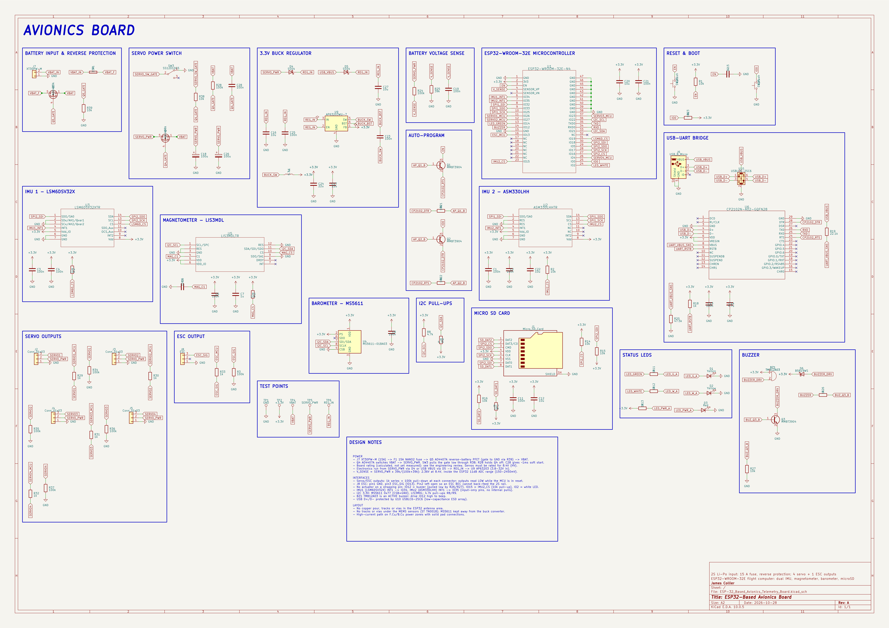
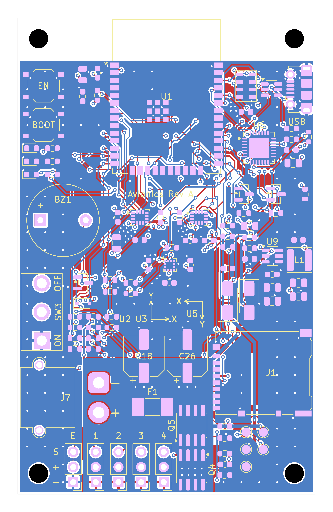
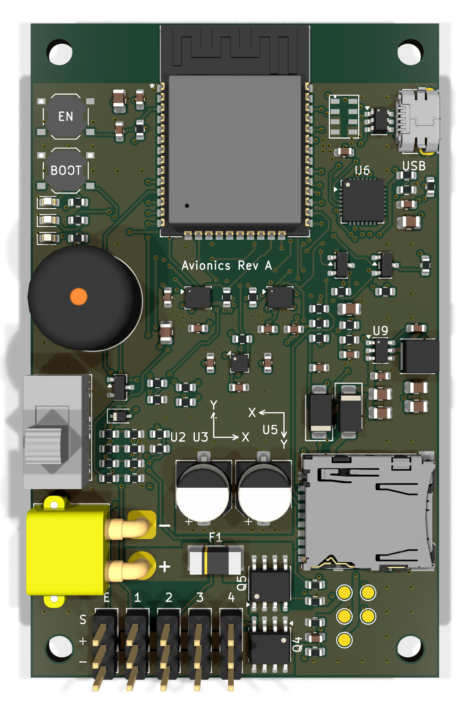

# ESP32-Based Avionics & Telemetry Board

[](LICENSE)
[](Software/LICENSE)
[](https://www.kicad.org/)

2S Li-Po flight computer built around an ESP32-WROOM-32E module. Fuses two IMUs, a magnetometer, and a barometer, logs flight data to microSD, and drives four servos and one ESC from a fused, reverse-polarity-protected battery input with a switched servo rail.

Designed for small fixed-wing aircraft with USB programming, multiple test points, and battery-voltage monitoring.

## Table of Contents
- [Schematic](#schematic)
- [Layout](#layout)
- [3D Model](#3d-model)
- [Overview](#overview)
- [Specifications](#specifications)
- [Results](#results)
- [Software](#software)
- [Tech Stack](#tech-stack)
- [Equipment](#equipment)
- [Manufacturing](#manufacturing)
- [Repository Structure](#repository-structure)
- [Contact](#contact)
- [License](#license)

## Schematic
[](Docs/Images/ESP-32_Based_Avionics_Telemetry_Board_Schematic.pdf)

## Layout


## 3D Model


## Overview

The board is a compact 4-layer flight computer centred on an ESP32-WROOM-32E module.

| Section                         | Description                                                                                                            |
| ---                             | ---                                                                                                                    |
| **Digital Core**                | The ESP32-WROOM-32E runs sensor fusion, logging, and actuator control, programmed through a CP2102N USB-UART bridge.   |
| **Sensors**                     | LSM6DSV32X and ASM330LHH IMUs on SPI, plus an LIS3MDL magnetometer and MS5611 barometer on I²C.                        |
| **Actuator Outputs**            | Four servo headers and one ESC header, each with a 1 kΩ series resistor and 100 kΩ pull-down to stay low through reset. |
| **User Interface**              | EN and BOOT buttons, three status LEDs, an active buzzer, and a microSD socket for data logging.                       |
| **Power**                       | An XT30 input feeds a 15 A fuse, P-FET reverse-battery protection, a switched servo rail, and an AP63203 3.3 V buck regulator. |

## Specifications

| Parameter                         | Value                                  |
| --------------------------------- | -------------------------------------- |
| **Microcontroller**               | ESP32-WROOM-32E-N4                     |
| **IMUs**                          | LSM6DSV32X and ASM330LHH, SPI          |
| **Magnetometer**                  | LIS3MDL, I²C                           |
| **Barometer**                     | MS5611-01BA03, I²C                     |
| **Storage**                       | microSD, SPI                           |
| **Outputs**                       | 4 servo + 1 ESC                        |
| **Power Input**                   | 2S Li-Po, 6.0–8.4 V                    |
| **Idle Current**                  | 48 mA (battery), 62 mA (USB)           |
| **Servo Rail Rating**             | 6 A continuous (calculated)            |
| **Regulation**                    | 3.301 V, 8.4 mVpp ripple               |
| **Board mass**                    | 18.4 g                                 |
| **Board size**                    | 80 mm × 50 mm                          |

## Results

PCB measurements from the JLCPCB-assembled prototype:

| Measurement           | Expected        | Measured          | Notes                            |
| --------------------: | --------------: | ----------------: | -------------------------------: |
| **VBAT**              | 7.4–8.4 V       | 8.21 V            | 2S Li-Po at ~80 % charge         |
| **SERVO_PWR**         | ≈ VBAT          | 8.19 V            | Q4 drop ≈ 20 mV                  |
| **REG_IN**            | Supply − Vf     | 7.92 V / 4.78 V   | From servo rail / USB            |
| **+3.3 V**            | 3.30 V ± 2 %    | 3.301 V           | 8.4 mVpp ripple at 1.1 MHz       |
| **V_SENSE**           | 2.30 V          | 2.31 V            | Battery-voltage ADC divider      |
| **Soft start**        | ~1 ms           | 1.1 ms            | Servo-rail switch-on             |
| **Reverse polarity**  | No conduction   | 0 mA              | −8.2 V on J7 for 5 s, no damage  |
| **IMU accel (Z)**     | +1.000 g        | +0.998 / +0.997 g | LSM6DSV32X / ASM330LHH, flat     |
| **IMU gyro**          | ~0 °/s          | < ±0.18 °/s       | Both IMUs, static                |
| **Magnetic field**    | Geomagnetic     | 28.5 / −1.2 / 41.0 µT | LIS3MDL, flat, north-aligned |
| **Pressure**          | ~1013 hPa       | 1013.2 hPa        | MS5611, 23.6 °C                  |
| **Soak temperature**  | No brown-out    | 41.2 °C           | ESP32 after 30 min, buck 38.7 °C |

USB programming, sensor IDs, I²C, microSD (SPI), and clean PWM edges (< 40 ns) on all outputs were verified using a digital multimeter, oscilloscope, bench power supply, and thermometer. Servo-rail load testing at 6 A, vibration, and EMI testing are still to be performed.

## Software

The diagnostic firmware targets the ESP32-WROOM-32E and is written in C with ESP-IDF.

### Programming

1. Install ESP-IDF (tested with v6.1-beta1).
2. Open [`Software/fc_diag`](Software/fc_diag) and run `idf.py set-target esp32`.
3. Build the firmware with `idf.py build`.
4. Connect the board over USB; the auto-program circuit enters the bootloader automatically.
5. Flash and monitor the firmware with `idf.py -p PORT flash monitor`.

## Tech Stack

| PCB Design | Firmware Development | Version Control | Repository Hosting | Language |
| :--------: | :------------------: | :-------------: | :----------------: | :------: |
|  |  |  |  |  |

## Equipment

| Tool                   | Model | Purpose                                              |
| ---------------------- | ----- | ---------------------------------------------------- |
| **Oscilloscope**       | —     | Soft-start, ripple, and PWM edge measurements        |
| **Multimeter**         | —     | Rail voltages, continuity, and current draw          |
| **Bench power supply** | —     | Current-limited power-up and reverse-polarity test   |
| **Thermometer**        | —     | Component temperatures during the soak test          |
| **Loupe (10×)**        | —     | Solder-joint and assembly inspection                 |
| **Soldering station**  | —     | Hand assembly of the through-hole components         |

## Manufacturing

Production files are provided in the [`Manufacturing`](Manufacturing/) directory:

- [`ESP-32_Based_Avionics_Telemetry_Board_Gerbers.zip`](Manufacturing/ESP-32_Based_Avionics_Telemetry_Board_Gerbers.zip) — Gerber and drill archive, ready to upload
- [`BOM.csv`](Manufacturing/Assembly/BOM.csv) — Bill of materials with LCSC part numbers (SMT parts)
- [`positions.csv`](Manufacturing/Assembly/positions.csv) — Component placement data (CPL)
- [`Hand_Assembly_THT.csv`](Manufacturing/Assembly/Hand_Assembly_THT.csv) — Through-hole parts to hand-solder
- [`CPL_rotation_review.csv`](Manufacturing/Assembly/CPL_rotation_review.csv) — Polarized parts to check in JLCPCB's placement preview
- [`Gerbers`](Manufacturing/Gerbers/) — Copper, mask, silkscreen, paste, outline, and drill files

### Ordering from JLCPCB

1. Upload the Gerber zip. Set **Layers: 4**, **Thickness: 1.6 mm**, **Stackup: JLC04161H-7628**, **Surface finish: ENIG**. Leave everything else at the default.
2. Enable **PCB Assembly**, top side only, and upload `BOM.csv` and `positions.csv`.
3. In the placement preview, check each part in `CPL_rotation_review.csv`, especially the diodes, LEDs, electrolytic capacitors, MOSFETs and ICs. Fix any rotations before confirming.
4. Hand-solder the through-hole parts in `Hand_Assembly_THT.csv` (buzzer, servo and ESC headers, XT30, slide switch). Their LCSC numbers are listed so they can be ordered from LCSC in the same order.

All 37 LCSC part numbers were in stock in the JLCPCB parts snapshot checked on 2026-11-09. Re-confirm live stock at checkout.

### Notes

- The servo rail (pin 2 of J2–J5) carries the battery voltage directly, up to 8.4 V. Use high-voltage (HV) servos rated for 2S.
- The ESC header's centre pin (J8 pin 2) is not connected, so the ESC's BEC cannot back-feed the board.

Design and manufacturing checks (ERC, DRC, BOM/CPL reconciliation, Gerber checks) are recorded in [`Docs/Verification`](Docs/Verification/VERIFICATION.md).

## Repository Structure

```text
ESP-32_Based_Avionics_and_Telemetry_Board
├── Docs                                                                           Contains board related images and verification records
│   ├── Images                                                                     Contains images of the board render, board layout, and board schematic
│   │   ├── ESP-32_Based_Avionics_Telemetry_Board_3D_Model.png                     3D model in PNG format
│   │   ├── ESP-32_Based_Avionics_Telemetry_Board_Layout.png                       Layout in PNG format
│   │   ├── ESP-32_Based_Avionics_Telemetry_Board_Schematic.png                    Schematic in PNG format
│   │   └── ESP-32_Based_Avionics_Telemetry_Board_Schematic.pdf                    Schematic in PDF format
│   └── Verification                                                               Contains ERC, DRC, BOM, and Gerber check records
│       ├── BOM_CPL_Check.json                                                     BOM and placement reconciliation
│       ├── DRC.rpt                                                                DRC report
│       ├── ERC.rpt                                                                ERC report
│       ├── Gerber_Check.txt                                                       Gerber and drill check
│       └── VERIFICATION.md                                                        Design-check summary
├── Hardware                                                                       Contains all KiCad PCB files
│   └── KiCad_Files                                                                Contains 3D models for board render, footprints for layout, KiCad project files, and symbols for schematic.
│       ├── 3D_Models                                                              Contains STEP files for the 3D render of the board
│       │   ├── Buzzer_12x9.5RM7.6.step                                            STEP for buzzer
│       │   ├── C_0603_1608Metric.step                                             STEP for 0603 capacitors
│       │   ├── C_0805_2012Metric.step                                             STEP for 0805 capacitors
│       │   ├── CP_Elec_6.3x5.4.step                                               STEP for electrolytic capacitors
│       │   ├── D_SMA.step                                                         STEP for SS54 diodes
│       │   ├── D_SOD-323.step                                                     STEP for B5819WS diode
│       │   ├── ESP32-WROOM-32E.step                                               STEP for ESP32-WROOM-32E module
│       │   ├── L_Changjiang_FNR4030S.step                                         STEP for buck inductor
│       │   ├── LED_0603_1608Metric.step                                           STEP for LEDs
│       │   ├── LGA-12_2x2mm_P0.5mm.step                                           STEP for LIS3MDL magnetometer
│       │   ├── LGA-14_3x2.5mm_P0.5mm_LayoutBorder3x4y.step                        STEP for IMUs
│       │   ├── Littelfuse_0451.step                                               STEP for 15 A fuse
│       │   ├── microSD_HC_Hirose_DM3AT-SF-PEJM5.step                              STEP for microSD socket
│       │   ├── Molex_105017-0001.step                                             STEP for USB Micro-B receptacle
│       │   ├── PinHeader_1x03_P2.54mm_Vertical.step                               STEP for servo and ESC headers
│       │   ├── QFN-28-1EP_5x5mm_P0.5mm_EP3.35x3.35mm.step                         STEP for CP2102N
│       │   ├── R_0603_1608Metric.step                                             STEP for 0603 resistors
│       │   ├── SOIC-8_3.9x4.9mm_P1.27mm.step                                      STEP for AO4407A MOSFETs
│       │   ├── SOT-23-6.step                                                      STEP for USBLC6-2SC6
│       │   ├── SOT-23.step                                                        STEP for MMBT3904 transistors
│       │   ├── SS12D10G5.step                                                     STEP for slide switch
│       │   ├── TS-1187A-B-A-B.step                                                STEP for tactile switches
│       │   ├── TSOT-23-6.step                                                     STEP for AP63203 buck regulator
│       │   └── XT30PW-M.step                                                      STEP for XT30 battery connector
│       ├── Footprints                                                             Contains footprints for PCB components
│       │   └── Avionics_Footprints.pretty                                         Contains custom board footprints
│       │       ├── ESP32-WROOM-32E_Espressif.kicad_mod
│       │       ├── SW_Slide_SPDT_Vertical_ShouHan_SS12D10_P4.8mm.kicad_mod
│       │       ├── TE_MS5611-01BA03_LGA-8_3x5mm_P1.25mm.kicad_mod
│       │       └── USB_Micro-B_Molex-105017-0001_EdgeSilk.kicad_mod
│       ├── ESP-32_Based_Avionics_Telemetry_Board.kicad_pcb                        KiCad PCB file
│       ├── ESP-32_Based_Avionics_Telemetry_Board.kicad_pro                        KiCad project file
│       ├── ESP-32_Based_Avionics_Telemetry_Board.kicad_sch                        KiCad Schematic file
│       ├── fp-lib-table
│       ├── sym-lib-table
│       └── Symbols                                                                Contains schematic symbols for PCB schematic
│           └── FC_Fixed.kicad_sym                                                 ESP32, CP2102N, sensor, and MS5611 symbols
├── LICENSE                                                                        CERN Open Hardware Licence Version 2 - Permissive for hardware
├── Manufacturing                                                                  Contains bill of materials, pick-and-place, and Gerber files.
│   ├── Assembly                                                                   Contains bill of materials and pick-and-place
│   │   ├── BOM.csv                                                                Bill of materials
│   │   ├── CPL_rotation_review.csv                                                Polarized parts placement review
│   │   ├── Hand_Assembly_THT.csv                                                  Through-hole parts for hand soldering
│   │   └── positions.csv                                                          Pick-and-place
│   ├── Gerbers                                                                    Contains Gerber files
│   │   ├── ESP-32_Based_Avionics_Telemetry_Board-B_Cu.gbl
│   │   ├── ESP-32_Based_Avionics_Telemetry_Board-B_Mask.gbs
│   │   ├── ESP-32_Based_Avionics_Telemetry_Board-B_Paste.gbp
│   │   ├── ESP-32_Based_Avionics_Telemetry_Board-B_Silkscreen.gbo
│   │   ├── ESP-32_Based_Avionics_Telemetry_Board-Edge_Cuts.gm1
│   │   ├── ESP-32_Based_Avionics_Telemetry_Board-F_Cu.gtl
│   │   ├── ESP-32_Based_Avionics_Telemetry_Board-F_Mask.gts
│   │   ├── ESP-32_Based_Avionics_Telemetry_Board-F_Paste.gtp
│   │   ├── ESP-32_Based_Avionics_Telemetry_Board-F_Silkscreen.gto
│   │   ├── ESP-32_Based_Avionics_Telemetry_Board-GND.g1
│   │   ├── ESP-32_Based_Avionics_Telemetry_Board-job.gbrjob
│   │   ├── ESP-32_Based_Avionics_Telemetry_Board-NPTH-drl_map.gbr
│   │   ├── ESP-32_Based_Avionics_Telemetry_Board-NPTH.drl
│   │   ├── ESP-32_Based_Avionics_Telemetry_Board-PTH-drl_map.gbr
│   │   ├── ESP-32_Based_Avionics_Telemetry_Board-PTH.drl
│   │   └── ESP-32_Based_Avionics_Telemetry_Board-PWR.g2
│   └── ESP-32_Based_Avionics_Telemetry_Board_Gerbers.zip                          Gerber archive for JLCPCB upload
├── Software                                                                       Contains C firmware and software license
│   ├── LICENSE                                                                    MIT License for firmware
│   └── fc_diag                                                                    ESP-IDF diagnostic firmware project
│       ├── CMakeLists.txt
│       ├── sdkconfig.defaults
│       └── main
│           ├── CMakeLists.txt
│           └── fc_diag.c                                                          Firmware for ESP32
└── README.md                                                                      Project README
```

## Contact
- GitHub: [@devjamescollier](https://github.com/devjamescollier)
- Email: [jwcollie@usc.edu](mailto:jwcollie@usc.edu)

## License

Copyright © 2026 James Collier

The hardware design files are licensed under the CERN Open Hardware
Licence Version 2 – Permissive. See [LICENSE](LICENSE).

The firmware is licensed under the MIT License. See
[Software/LICENSE](Software/LICENSE).
